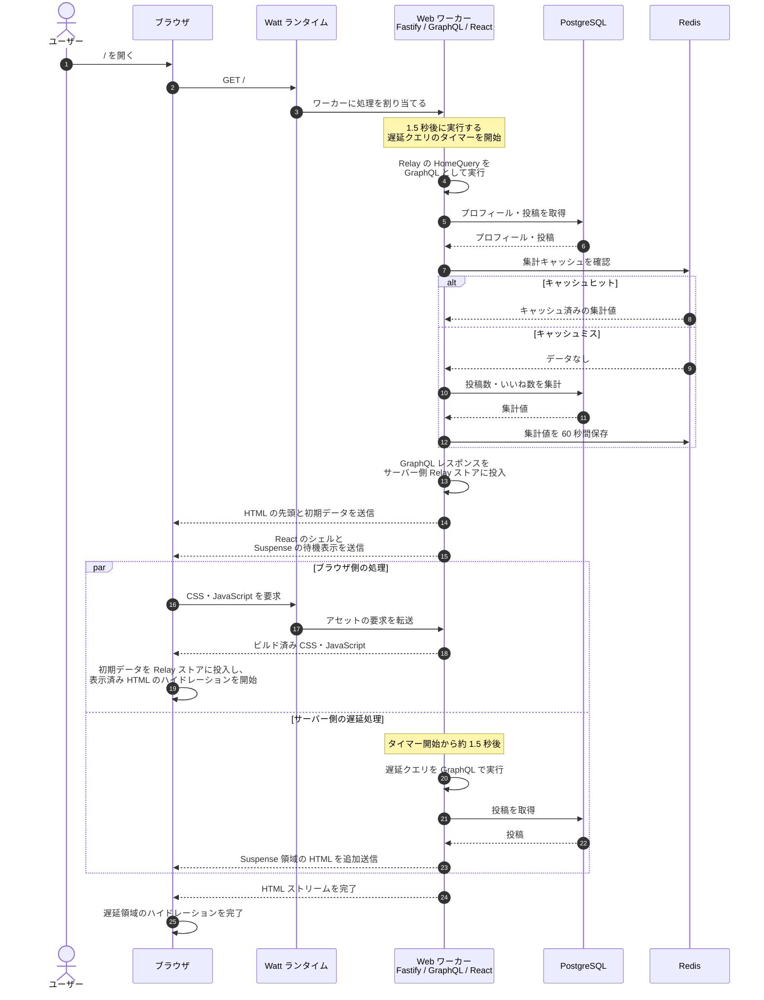

# Town Square / Lab

X の技術スタックを参考にした、1 ページの実装サンプルです。React のストリーミング SSR、Relay と GraphQL、Fastify と Watt、PostgreSQL と Redis の接続を確認できます。

## 起動

Docker と Docker Compose を用意し、リポジトリのルートで次のコマンドを実行します。

```sh
docker compose up --build
```

起動後、`http://localhost:3000` を開きます。初回の PostgreSQL 起動時には、`docker/postgres/001-init.sql` がスキーマとサンプルデータを作成します。

データを維持したまま停止するには `docker compose down`、データも消して初期化し直すには `docker compose down -v` を実行します。

ローカルビルドには Node.js 26 と pnpm 12 が必要です。`pnpm install` と `pnpm build` でビルドできます。ローカルで Web を Watt 経由で起動する場合は、`DATABASE_URL`、`REDIS_URL`、`PORT` を設定して `pnpm dev` を実行してください。

Compose では Watt のランタイム、ワーカー、Service をバンドルし、Fastify をワーカー上で起動します。実行用イメージには Rolldown のビルド成果物だけを含めます。サーバービルド時は、生成されたチャンクに Node.js 組み込みモジュール以外の外部 import が残らないよう検査します。

## ページ表示の流れ

次の図は、Compose の各サービスが起動した後に `http://127.0.0.1:3000/` を開いたときの流れです。Web コンテナでは Watt が2つのワーカースレッドを管理し、そのうち1つがリクエストを処理します。Fastify、GraphQL、React のサーバー側の処理は、このワーカー内で実行されます。



1. ブラウザが `/` を要求すると、Watt が Fastify のワーカーに処理を割り当てます。ワーカーは遅延表示用のタイマーを開始してから、初期表示用の `HomeQuery` を実行します。
2. GraphQL はプロフィールと投稿を PostgreSQL から取得します。集計値は Redis のバージョン付きキーを確認し、キャッシュがなければ PostgreSQL で集計して Redis に保存します。図では簡潔に順序を表していますが、GraphQL のフィールドは並行して解決される場合があります。
3. サーバー側では GraphQL レスポンスを Relay ストアに投入し、初期データを安全にシリアライズして HTML に埋め込みます。React はシェルを先に描画し、遅延データを使う `Suspense` 領域には待機表示を出します。
4. ブラウザは CSS と JavaScript を読み込み、HTML に埋め込まれたレスポンスを Relay ストアに再投入します。これにより初期表示のデータを `/graphql` に再要求せず、シェルのハイドレーションを開始できます。タイマー完了後には、サーバーが遅延クエリを実行し、その結果を使う領域の HTML を同じ応答に追加します。ブラウザは文書の完了後に遅延領域の成功・失敗を判定し、その領域のハイドレーションを完了します。

図中の初期クエリと遅延クエリは、Web ワーカー内から GraphQL スキーマを直接実行します。ブラウザが `/graphql` にリクエストを送るのは、表示後のいいね操作などのタイミングです。いいね時には Relay mutation が投稿を更新し、Redis の集計キャッシュのバージョンを進めます。

## 主なライブラリと責務

各技術の役割と、このサンプルでの使い方を説明します。リクエストを受ける Watt・Fastify、データを扱う GraphQL・Relay、画面を描画する React の順にコードを追えます。

### Watt・Fastify: サーバーを動かし、リクエストを受ける

- [Watt](https://docs.platformatic.dev/) は Node.js アプリケーションサーバーです。このサンプルでは Fastify アプリケーションを2つのワーカースレッドで動かし、ワーカーの起動や終了を管理します。設定は `apps/web/watt.json`、コンテナ内で使うランタイム・ワーカーのバンドル処理は `apps/web/scripts/build-watt.mjs` にあります。
- [Fastify](https://fastify.dev/) は Node.js の Web フレームワークです。Watt のワーカー内で HTTP リクエストを受け、`/` の SSR、`/health`、静的アセット配信などを担当します。ルートやプラグインの登録は `apps/web/src/server.tsx` にあります。

Watt はアプリケーションを動かす側、Fastify は各 HTTP リクエストを処理する側です。

### GraphQL・Mercurius: データの窓口を定義する

- [GraphQL](https://graphql.org/) は、クライアントが必要なデータの形を指定するための問い合わせ言語と実行仕様です。このサンプルでは `packages/graphql/schema.graphql` にプロフィール・投稿・集計・いいね操作を定義し、`@graphql-tools/schema` でスキーマとリゾルバーを結び付けています。リゾルバーは `packages/database` の関数を呼びます。
- [Mercurius](https://mercurius.dev/) は GraphQL を Fastify に組み込むプラグインです。`/graphql` を提供し、ブラウザから送られるいいね mutation などを受け付けます。初回 SSR のクエリは HTTP を経由せず、Web ワーカー内で `graphql` 関数を直接呼び出します。

### Relay: React が使う GraphQL データを管理する

[Relay](https://relay.dev/docs/) は React 向けの GraphQL クライアントです。クエリや mutation の実行と、取得したデータのストアへの保存・更新を担当します。各コンポーネントが必要なフィールドを宣言できるのが特徴です。

このサンプルでは `apps/web/src/relay.ts` の `HomeQuery` がページ全体のデータを要求し、`apps/web/src/PostCard.tsx` のフラグメントが投稿カードに必要なフィールドを宣言します。`useMutation` はいいねを送信し、返ってきた投稿 ID といいね数を Relay ストアに反映します。SSR で取得したレスポンスもブラウザ側のストアに投入するため、初回表示の同じクエリを再取得せずに済みます。集計値の再取得は Relay ではなく、`App.tsx` の `fetch` で行っています。

`pnpm relay` で実行する Relay Compiler は、ソース内の GraphQL 定義とスキーマから実行用のコードと型を生成します。生成物は各ソースの `__generated__` にあります。

### React: 画面を描画し、操作可能にする

[React](https://react.dev/) はコンポーネントから UI を組み立てるライブラリです。同じコンポーネントを使い、サーバーでは `renderToPipeableStream` で HTML をストリーミングし、ブラウザでは `hydrateRoot` で表示済みの HTML を操作可能にします。`Suspense` は遅延クエリの結果が届くまで、その領域に待機表示を出します。

主な画面は `apps/web/src/App.tsx`、サーバー描画は `apps/web/src/server.tsx`、ブラウザでのハイドレーションは `apps/web/src/entry-client.tsx` にあります。

### Vite・Rolldown: 実行用のコードをビルドする

[Vite](https://vite.dev/) はフロントエンドの開発・ビルドツールで、[Rolldown](https://rolldown.rs/) はコードをまとめるバンドラーです。このサンプルでは Vite 経由で、ブラウザ用と SSR サーバー用に別々の成果物を作ります。Watt とそのワーカーも別エントリーポイントとしてバンドルし、実行用コンテナには成果物をコピーします。

設定は `apps/web/vite.config.ts`、ビルドコマンドは `apps/web/package.json` にあります。`pnpm dev` はビルド後の成果物を Watt で起動します。Vite の開発サーバーは使用しません。

### Base UI・Tailwind CSS: 操作部品と見た目を作る

- [Base UI](https://base-ui.com/) は、アクセシビリティや操作動作を備えた UI 部品を提供します。ここでは `packages/ui/src/index.tsx` の「このサンプルについて」ダイアログに使っています。
- [Tailwind CSS](https://tailwindcss.com/) はスタイルを作るためのツールです。Vite プラグインを通じて CSS を処理します。このサンプルの画面スタイルの多くは、`apps/web/src/styles.css` の通常の CSS クラスとして定義しています。

### PostgreSQL・Redis: データを保存し、集計をキャッシュする

[PostgreSQL](https://www.postgresql.org/) はプロフィール、投稿、いいね数の保存先です。[Redis](https://redis.io/) は投稿数といいね数の集計結果を一時保存します。これらはライブラリではなく、Compose で起動する別々のサービスです。アプリケーションからはそれぞれ `pg` と `redis` パッケージで接続します。

DB 接続と SQL、キャッシュの取得・無効化は `packages/database/src/index.ts`、初期データは `docker/postgres/001-init.sql` にあります。

## コードの場所

- `apps/web/src/server.tsx`: Fastify、GraphQL、初期データ取得とストリーミング SSR
- `apps/web/src/relay.ts`: Relay 環境とサーバーレスポンスのストアへの投入
- `apps/web/src/App.tsx`: ページ、Suspense、集計表示
- `apps/web/src/PostCard.tsx`: Relay フラグメントといいね mutation
- `packages/graphql`: GraphQL スキーマとリゾルバー
- `packages/database`: PostgreSQL と Redis、キャッシュの無効化
- `packages/ui`: Base UI ダイアログと共通 UI
- `apps/web/watt.json`: Watt のサーバー・ワーカー設定
- `apps/web/scripts/build-watt.mjs`: Watt とワーカーのバンドル

`pnpm relay` で Relay のコードを生成します。`pnpm typecheck`（tsrs、TypeScript 7 系）と `pnpm lint`（oxlint）で静的検査を、`pnpm format`（oxfmt）で整形を実行できます。`pnpm-workspace.yaml` の `minimumReleaseAge: 2880` は、新しい依存パッケージのバージョンを公開後 2 日間待ってから解決する設定です。

認証のない検証用アプリです。いいねは誰でも操作でき、Compose 内の DB 認証情報もローカル向けです。公開サービスとして利用する設定ではありません。
