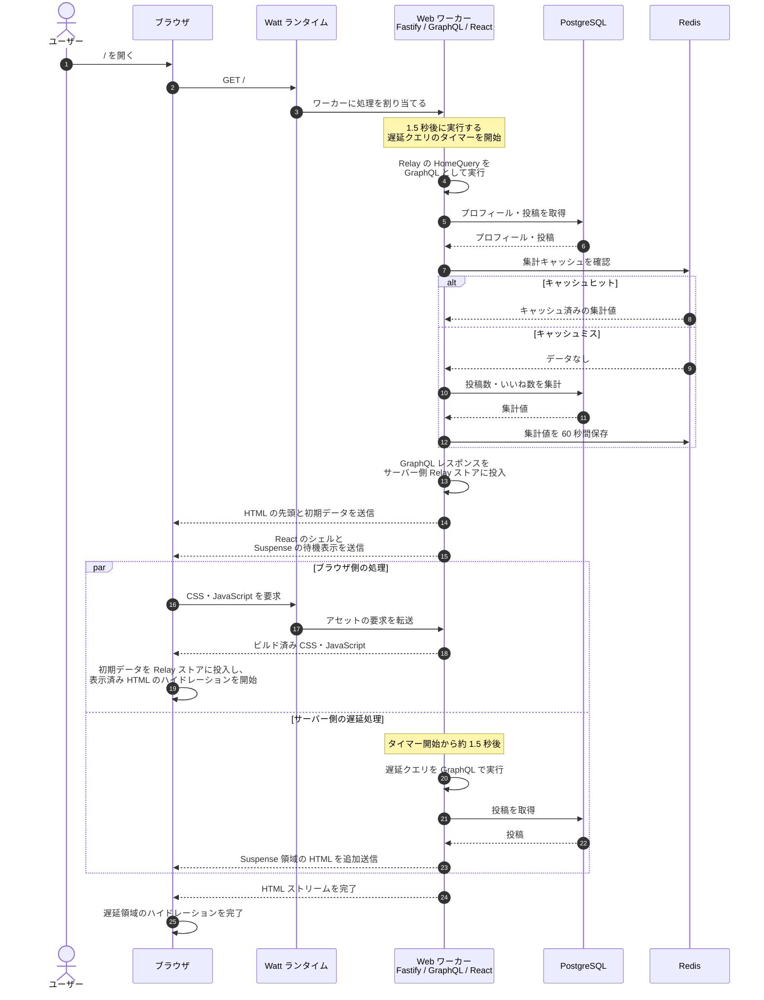

# Town Square / Lab

X の技術スタックを参考にした、1 ページの実装サンプルです。React のストリーミング SSR、Relay と GraphQL、Fastify と Watt、PostgreSQL と Redis の接続を確認できます。

## 起動

Docker と Docker Compose を用意し、ルートで実行します。実行用イメージには Rolldown によるビルド成果物だけを含めます。サーバービルド時は、生成されたチャンクに Node.js 組み込みモジュール以外の外部 import が残らないよう検査します。Compose ではバンドル済みの Watt が Fastify をワーカー上で起動します。

```sh
docker compose up --build
```

`http://localhost:3000` を開きます。初回は PostgreSQL の起動時に `docker/postgres/001-init.sql` がスキーマとサンプルデータを作成します。データを維持したまま停止する場合は `docker compose down`、データも消して初期化し直す場合は `docker compose down -v` を使います。

ローカルビルドには Node.js 26 と pnpm 12 が必要です。`pnpm install`、`pnpm build` でビルドできます。ローカルで Web を Watt 経由で起動する場合は `DATABASE_URL`、`REDIS_URL`、`PORT` を設定して `pnpm dev` を実行してください。Compose の構成でも Watt のランタイム、ワーカー、Service をバンドルして起動します。

## ページ表示の流れ

次の図は、Compose の各サービスが起動した後に `http://127.0.0.1:3000/` を開いたときの流れです。Web コンテナでは Watt が2つのワーカースレッドを管理し、そのうち1つがリクエストを処理します。Fastify、GraphQL、React のサーバー側の処理は、このワーカー内で実行されます。



1. **ブラウザと Watt**: ブラウザが `/` を要求すると、Watt が Fastify のワーカーに処理を割り当てます。ワーカーは遅延表示用のタイマーを開始してから、初期表示用の `HomeQuery` を実行します。
2. **GraphQL とデータストア**: GraphQL はプロフィールと投稿を PostgreSQL から取得します。集計値は Redis のバージョン付きキーを確認し、キャッシュがなければ PostgreSQL で集計して Redis に保存します。図では簡潔に順序を表していますが、GraphQL のフィールドは並行して解決される場合があります。
3. **サーバー側の Relay と React**: GraphQL レスポンスを Relay ストアに投入し、初期データを安全にシリアライズして HTML に埋め込みます。React はシェルを先に描画し、遅延データを使う `Suspense` 領域には待機表示を出します。
4. **ストリーミングとハイドレーション**: ブラウザは CSS と JavaScript を読み込み、HTML に埋め込まれたレスポンスを Relay ストアに再投入します。これにより初期表示のデータを `/graphql` に再要求せず、シェルのハイドレーションを開始できます。タイマー完了後には、サーバーが遅延クエリを実行し、その結果を使う領域の HTML を同じ応答に追加します。ブラウザは文書の完了後に遅延領域の成功・失敗を判定し、その領域のハイドレーションを完了します。

図中の初期クエリと遅延クエリは、Web ワーカー内から GraphQL スキーマを直接実行します。ブラウザが `/graphql` にリクエストを送るのは、表示後のいいね操作などのタイミングです。いいね時には Relay mutation が投稿を更新し、Redis の集計キャッシュのバージョンを進めます。

## コードの場所

- `apps/web/src/server.tsx`: Fastify、GraphQL、初期データ取得とストリーミング SSR
- `apps/web/src/relay.ts`: Relay 環境とサーバーレスポンスのストアへの投入
- `apps/web/src/App.tsx`: ページ、Suspense、集計表示
- `apps/web/src/PostCard.tsx`: Relay フラグメントといいね mutation
- `packages/graphql`: GraphQL スキーマとリゾルバー
- `packages/database`: PostgreSQL と Redis、キャッシュの無効化
- `packages/ui`: Base UI ダイアログと共通 UI
- `apps/web/watt.json`: Watt のサーバー・ワーカー設定
- `apps/web/scripts/build-watt.mjs`: Watt とワーカーのバンドル

`pnpm relay` で Relay のコードを生成します。`pnpm typecheck`（tsrs、TypeScript 7 系）と `pnpm lint`（oxlint）で静的検査を、`pnpm format`（oxfmt）で整形を実行できます。`pnpm-workspace.yaml` の `minimumReleaseAge: 2880` は新規依存バージョンの公開後 2 日間の待機を指定します。

認証のない検証用アプリです。いいねは誰でも操作でき、Compose 内の DB 認証情報もローカル向けです。公開サービスとして利用する設定ではありません。
